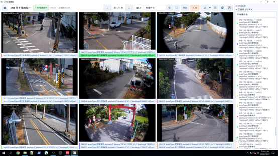
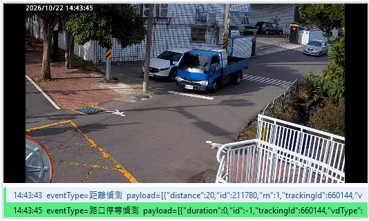
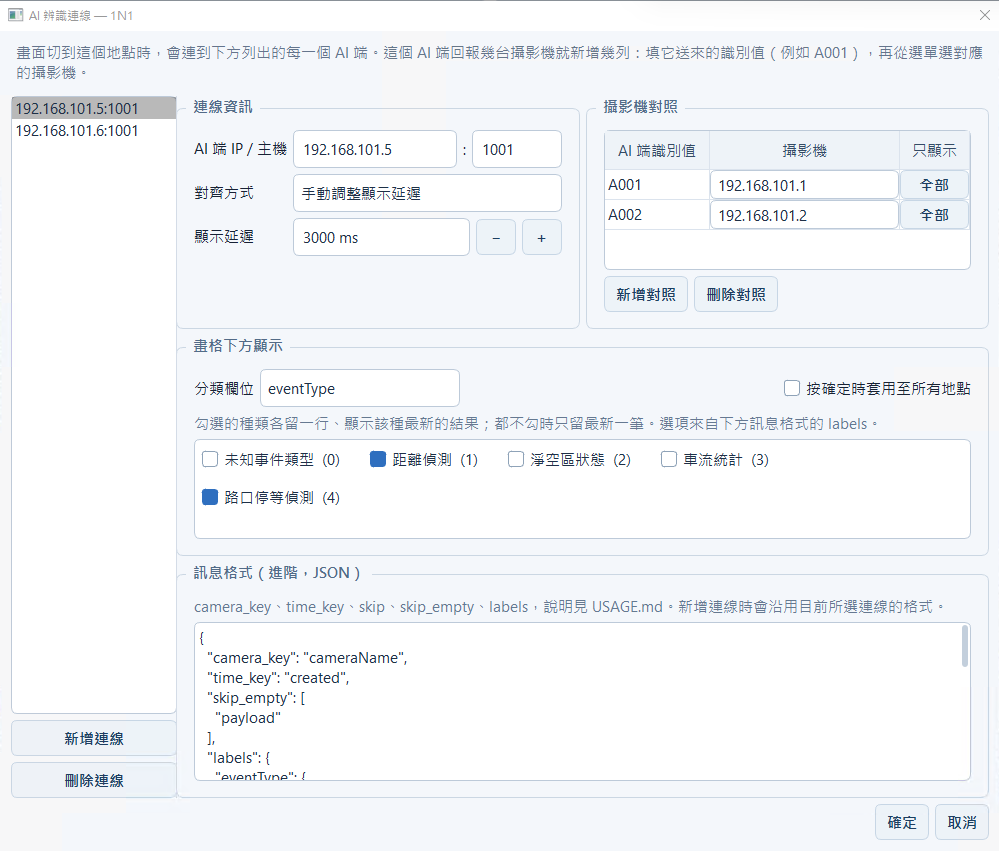
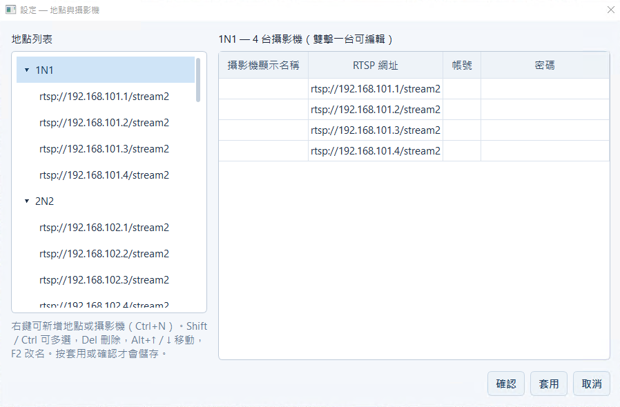

<div align="center">

# CCTV Wall

**Windows 桌面影像牆：多個地點的 RTSP 監視器與本機影片，排在同一面牆上播放，並可疊上 AI 辨識結果。**

為低階電腦與遠端桌面觀看而設計，打包成單一 exe，現場電腦不必安裝任何東西。

[](https://github.com/ShowXD/cctv-wall/actions/workflows/ci.yml)
[](https://github.com/ShowXD/cctv-wall/actions/workflows/release.yml)
[](https://github.com/ShowXD/cctv-wall/releases/latest)
[](LICENSE)
[](https://www.python.org/downloads/)
[](#下載)

[下載](#下載) · [功能](#功能) · [快速開始](#快速開始) · [從原始碼建置](#從原始碼建置) · [文件](#文件)

</div>



| 畫格下方的 AI 結果 | AI 辨識連線設定 | 地點與攝影機 |
| :---: | :---: | :---: |
|  |  |  |

## 功能

### 影像牆

- 依地點管理攝影機，只連線畫面上的那一頁，其餘不建立連線也不解碼
- 每頁 1–36 格，自動排成接近正方形；格子之間的間隔可拖曳調整，版面關閉後記住，一鍵回復預設
- 跨地點挑選攝影機一起看：`Ctrl`／`Shift` 多選後按右鍵「同時播放」
- 雙擊單格放大、`Esc` 還原；`PgUp`／`PgDn` 翻頁、`F11` 全螢幕
- 單格斷線自動退避重連（5→10→20→30 秒），失敗只影響那一格
- 一鍵在每格角落顯示解析度、實際 fps、丟幀、位元率與重連次數

### AI 辨識結果

- 從 TCP 接收每行一筆的 JSON，依攝影機對到畫格，顯示在畫格下方與側欄
- 兩種對齊方式：與畫面時間戳一致（讀取每格畫面的 RTCP/NTP 拍攝時間），或手動調整顯示延遲
- 畫格下方可依分類各留一行最新結果，可指定某台攝影機只顯示特定種類
- 只連線畫面上攝影機對到的 AI 來源，每格以不同顏色對應

### 播放與部署

- 兩套播放後端：VLC（一般播放，需求最低）與 GStreamer（RTCP/NTP 嚴格時間戳同步）
- 影像一律靜音，GPU 解碼，針對低階電腦與遠端桌面調校
- 單一 exe 內含 VLC 與 GStreamer，同一個檔案支援 Windows 10 與 11

### 介面與設定

- 設定視窗支援確認／套用／取消、多選與快捷鍵（`Del`、`Alt+↑/↓`、`F2`、`Ctrl+N`）
- 繁體中文／English、跟隨系統／深色／淺色，即時切換、影像不中斷
- 所有設定存在 exe 旁的 `workspace.json`，RTSP 密碼以 Windows DPAPI 加密
- 內建事件紀錄，不必開終端機就能查看失敗原因

### 不做的事

錄影、PTZ 控制、移動偵測、ONVIF 自動搜尋、多螢幕佈局、程式內更新。

## 下載

| 版本 | 說明 |
| --- | --- |
| [最新正式版](https://github.com/ShowXD/cctv-wall/releases/latest) | 下載 `CCTVWall.exe` |
| [`main-build`](https://github.com/ShowXD/cctv-wall/releases/tag/main-build) | `main` 最新一次建置，每次合併都會更新，未經正式發布 |

需求：Windows 10 或 11（x64）。exe 內含所有執行元件，不必另外安裝 VLC 或 Python。

## 快速開始

1. 把 `CCTVWall.exe` 放到任意資料夾，先執行診斷：

   ```powershell
   CCTVWall.exe --check
   ```

   `libvlc` 那一行要有版本號。

2. 開啟程式，用左下角的「地點與攝影機」新增地點與攝影機：填名稱、RTSP 網址、帳號、密碼即可，
   含帳密的網址也可以直接貼上。也可以從 [`workspace.example.json`](workspace.example.json)
   複製成 exe 旁的 `workspace.json` 再修改。

3. 點左側的地點開始播放。操作方式見 [使用說明](docs/USAGE.md)。

## 從原始碼建置

需要 [uv](https://docs.astral.sh/uv/)，以及與 Python 位元數相同的 [VLC](https://www.videolan.org/)（64-bit Python 配 64-bit VLC）。

```bash
git clone https://github.com/ShowXD/cctv-wall.git
cd cctv-wall
uv sync                       # 建立環境：Qt、python-vlc、GStreamer、PyInstaller
uv run cctv-wall              # 啟動
```

| 指令 | 用途 |
| --- | --- |
| `uv run cctv-wall --check` | 環境診斷：設定檔位置、libvlc 版本、嚴格同步是否可用 |
| `uv run cctv-wall --dry-run` | 用假的播放後端建出整個介面後結束，不需要 VLC |
| `uv run --group dev pytest -q` | 執行測試（不需要 VLC、不連網） |
| `uv run build cctv-wall` | 打包成單一 exe，輸出到 `dist/releases/` |

推送到 `main` 會由 GitHub Actions 自動打包並更新 `main-build`；推送 `v*` tag 則建立正式 Release。
詳見 [打包與部署](docs/BUILD.md)。

## 文件

| 文件 | 內容 |
| --- | --- |
| [使用說明](docs/USAGE.md) | 主畫面操作、快捷鍵、設定視窗、AI 結果對照、`workspace.json` 欄位 |
| [打包與部署](docs/BUILD.md) | 打包指令、自動發布、exe 體積、Windows 10 相容性 |
| [架構](docs/ARCHITECTURE.md) | 模組分層、效能設計 |
| [疑難排解](docs/TROUBLESHOOTING.md) | 症狀對照表、嚴格時間戳同步 |
| [開發筆記](docs/HANDOFF.md) | 程式碼看不出來的決策與踩過的陷阱 |

## 技術

PySide6（Qt Widgets）· libvlc（python-vlc）· GStreamer（PyGObject）· uv · PyInstaller

領域層（地點、攝影機、AI 訊息解析）不依賴 Qt 或 VLC；播放只經過 `Player` 介面，VLC 與 GStreamer
各一個實作；`workspace.json` 只由 `repository.py` 讀寫。

## 參與貢獻

歡迎提出 issue 與 pull request，流程與送出前的檢查見 [CONTRIBUTING.md](CONTRIBUTING.md)。

`workspace.json` 含攝影機位址與帳號，已列入 `.gitignore`，請勿提交。發現安全性問題請依
[SECURITY.md](SECURITY.md) 私下回報，不要開公開 issue。

## 授權

[MIT](LICENSE) © 薛佾展
